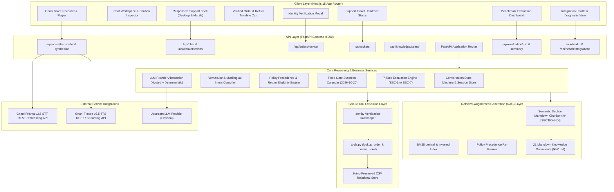
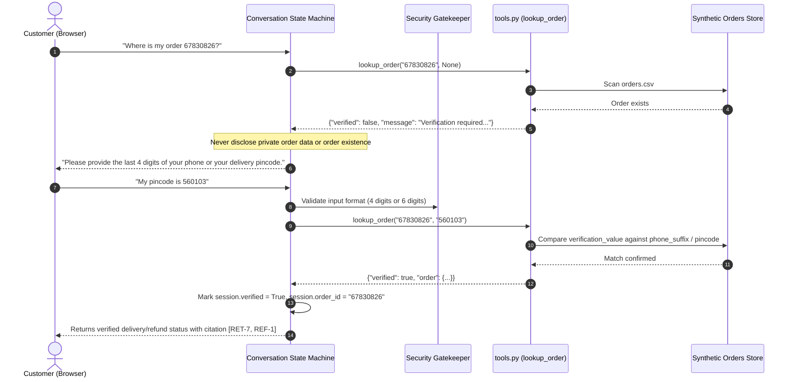
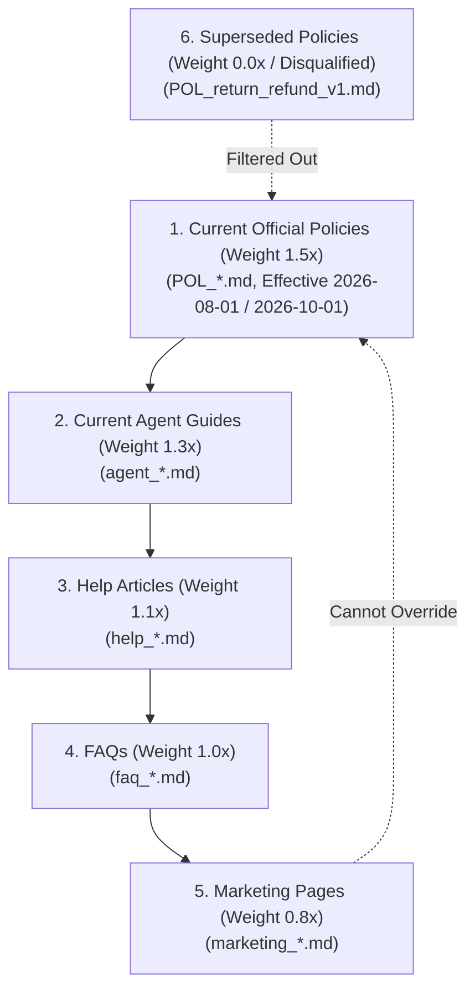
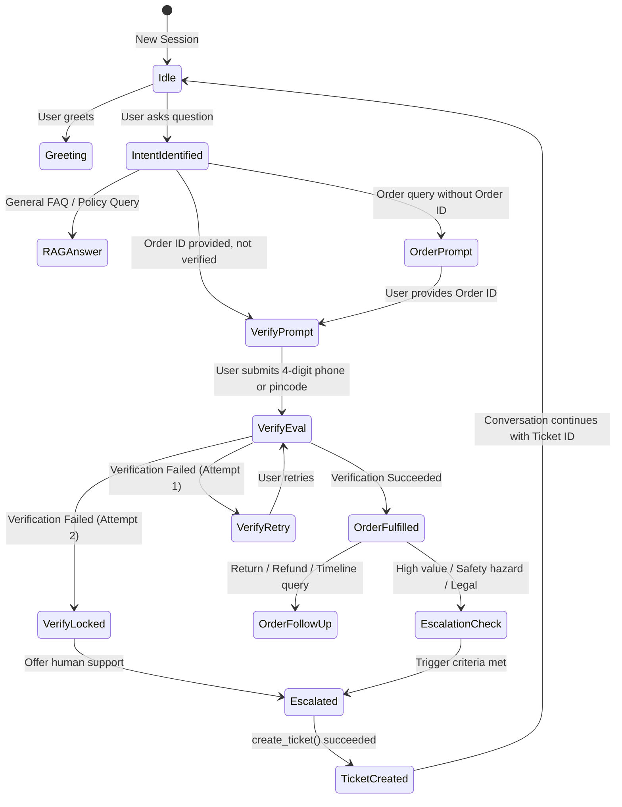
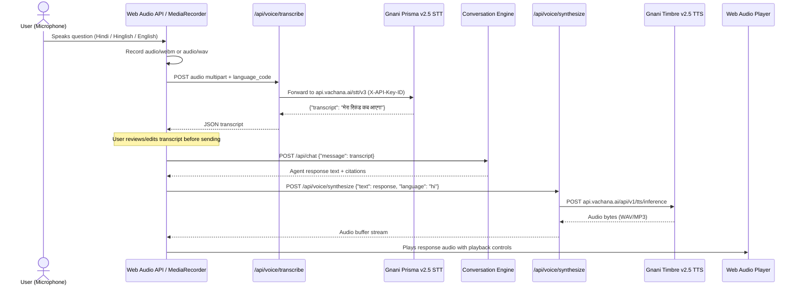

# ZentroMart AI Customer Support Platform: System Architecture

## 1. Architectural Overview

ZentroMart AI Customer Support Platform is an enterprise-grade conversational AI application designed for Indian e-commerce support. The platform pairs deterministic business logic and policy precedence rules with hybrid knowledge retrieval (BM25 + semantic) and a conversational AI model adapter, supported by Indian vernacular voice capabilities via Gnani AI.

### High-Level Architecture Diagram

---

## 2. Component Breakdown

### 2.1 Backend Services (`backend/app/`)

| Module | Responsibility | Key Interfaces |
|---|---|---|
| `app.core.dataset_loader` | String-preserving loader for 9 CSV tables (1,000 orders, 70 products, 300 customers, 1,783 items, holidays, pincodes, logs). Relational join resolution. | `get_order(id)`, `get_customer(id)`, `get_product(sku)`, `get_pincode(pin)` |
| `app.core.business_calendar` | Date calculations anchored to reference date **20 October 2026**. Monday–Saturday business days, Sunday exclusion, 4 warehouse holiday exclusions. | `add_business_days()`, `diff_business_days()`, `format_bilingual_date()` |
| `app.services.retrieval` | Document ingestion of 21 markdown files. Chunks by `## [SECTION-ID]`. BM25 ranker with policy document weight multipliers and multilingual synonym expansion. | `search(query, top_k, min_score)` |
| `app.services.policy_engine` | Return windows by product category (clothing: 7d, electronics: 7d [10d pre-Aug-1], large appliances: 10d, footwear: 14d, books: 7d, beauty/grocery: non-returnable). Festive sale extension (RET-8). | `check_return_eligibility()`, `calculate_refund_timeline()` |
| `app.services.escalation` | Evaluates 7 mandatory escalation rules. Formats detailed handover summaries ($\ge 20$ chars) and calls `create_ticket`. | `evaluate_escalation()`, `dispatch_ticket()` |
| `app.services.conversation` | Multi-turn state machine. Manages session lifecycles, verification challenges, retry tracking (max 1 retry), tool execution, and citation aggregation. | `handle_message()`, `reset_session()` |
| `app.services.voice_service` | Gnani Prisma v2.5 STT (`api.vachana.ai/stt/v3`) & Timbre v2.5 TTS (`api.vachana.ai/api/v1/tts/inference`) with honest unconfigured fallback. | `transcribe_audio()`, `synthesize_speech()` |
| `app.services.evaluation` | Automated benchmark harness for 52 practice questions and 23 multi-turn conversations. Computes fact coverage, forbidden checks, tool decisions, and evidence accuracy. | `evaluate_questions()`, `evaluate_conversations()` |
| `app.tools.tools_adapter` | Safe proxy to `tools.py`. Enforces `lookup_order` verification contract and `create_ticket` summary length validation. | `lookup_order()`, `create_ticket()` |

---

## 3. Data Flow & Security Boundaries

### 3.1 Order Lookup & Verification Sequence

### 3.2 Security Boundaries

1. **Client Isolation**: The browser client receives only sanitized responses. Unverified lookup requests never receive order items, totals, tracking numbers, or customer names.
2. **Session Boundary**: Verification status is tied exclusively to the active `conversation_id` and specific `order_id`. A client cannot use verification of Order A to query Order B.
3. **Retry Exhaustion**: After 2 failed verification attempts (initial + 1 retry), the order is locked for that session, and human assistance is offered.

---

## 4. Policy Precedence Engine

The system strictly enforces the hierarchy specified in `kb/00_about_this_knowledge_base.md`:

### Temporal Precedence Rules
- **Electronics Return Window Transition (`RET-3`)**:
  - Orders placed **before 2026-08-01**: 10-day return window.
  - Orders placed **on or after 2026-08-01**: 7-day return window.
- **Festive Season Promotional Extension (`RET-8`)**:
  - Orders placed **between 2026-10-01 and 2026-10-15**: 30-day extended return window across all returnable categories.

---

## 5. Multi-Turn Conversation State Machine

---

## 6. Voice Processing Pipeline (Gnani AI)

If `GNANI_API_KEY` is not present, the voice endpoints return HTTP 503 with `"status": "unconfigured"`, and the frontend displays a clear status pill without blocking text chat.
